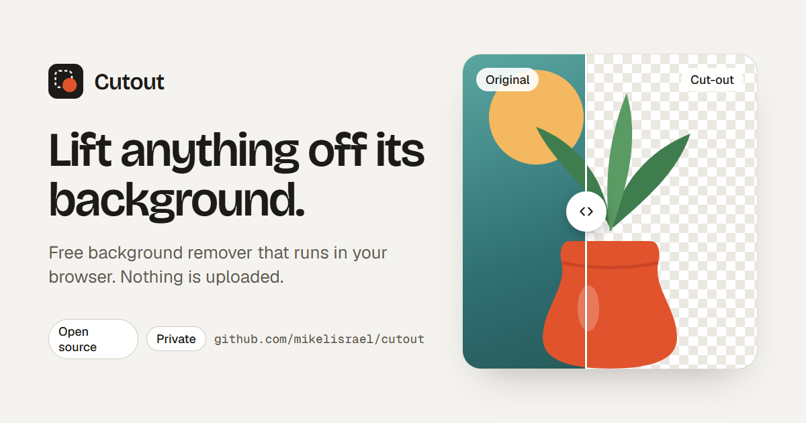

<p align="center">
  
</p>

<h1 align="center">Cutout</h1>

<p align="center">
  A free, open-source background remover that runs entirely in your browser.<br />
  Your photos never leave your device: no uploads, no accounts, no watermarks.
</p>

---

## Features

- **One step.** Drop, paste or pick images (or take a photo on your phone) and get a cut-out in seconds.
- **Private by design.** The AI model runs on your device in a Web Worker. Nothing is sent to a server.
- **Full resolution.** Exports at your photo's original size.
- **Batch.** Add as many images as you like; they're processed one after another.
- **Backgrounds.** Transparent, white, black, soft presets or any colour.
- **Before / after slider** to check the edges.
- **Light and dark** themes, with a switch.
- **Phone-friendly.** Save straight to Photos or WhatsApp through the share sheet, install it to your home screen.

## How it works

1. **The model downloads once.** The first time you open Cutout, your browser downloads a neural network (BiRefNet, about 115–190 MB) from Hugging Face's CDN and caches it. Later visits load it from your disk.
2. **It runs on your device.** [Transformers.js](https://github.com/huggingface/transformers.js) runs the model with ONNX Runtime Web, on your GPU through WebGPU when the browser and GPU support it, otherwise on the CPU through WebAssembly.
3. **The model draws a mask.** For every pixel it estimates how much of it belongs to the subject. Cutout uses that mask as the image's transparency at full resolution.
4. **Backgrounds are painted on export.** Choosing a colour only fills behind the cut-out; nothing is processed again.

| Path | Model | Used when |
|---|---|---|
| GPU (WebGPU, fp16) | [`onnx-community/BiRefNet_lite-ONNX`](https://huggingface.co/onnx-community/BiRefNet_lite-ONNX), 1024 px | the GPU can run it (checked with a warm-up pass) |
| CPU (WebAssembly, fp32) | [`studioludens/birefnet-lite-512`](https://huggingface.co/studioludens/birefnet-lite-512), 512 px | no WebGPU, or the GPU can't run the larger model |

Both models are MIT-licensed. If a GPU fails its warm-up, the browser remembers it and uses the CPU path from then on.

## Run it locally

Needs Node 20+ and [pnpm](https://pnpm.io).

```sh
git clone https://github.com/mikelisrael/cutout.git
cd cutout
pnpm install
pnpm dev
```

Open the URL Vite prints (usually http://localhost:5173).

| Command | What it does |
|---|---|
| `pnpm dev` | development server |
| `pnpm check` | typecheck, formatting check and production build: run before every pull request |
| `pnpm build` | static build in `dist/` |
| `pnpm format` | format `src/` with Prettier |

## Deploy

It's a static site: no server, no API keys, no special headers.

- **Vercel:** import the repo; the defaults (Vite, `pnpm build`, output `dist`) work as is.
- **Anywhere else:** run `pnpm build` and serve `dist/`.

## Project layout

```
src/
  App.tsx                         the screens and state
  components/                     Compare slider, Queue, Toolbar, file intake, icons
  lib/useRemover.ts               talks to the worker, queues images
  lib/compose.ts                  applies the mask, exports PNG
  lib/useTheme.ts                 light / dark
  worker/removeBackground.worker.ts   loads the model, picks GPU or CPU, runs it
docs/
  design/DESIGN_SYSTEM.md         colours, type, motion, the checklist for anything new
  todo.md                         the roadmap
```

## Roadmap

The phases to make Cutout state of the art (sharper edges on large photos, erase/restore brushes, shadows, size presets, stickers, offline support and more) are in [`docs/todo.md`](docs/todo.md).

## Contributing

Issues and pull requests are welcome.

- Keep the promise: **no feature may upload a user's image** or send image data anywhere.
- Follow [`docs/design/DESIGN_SYSTEM.md`](docs/design/DESIGN_SYSTEM.md); check changes on a phone-sized screen and in both themes.
- Run `pnpm check` before opening a pull request.

## Credits

- [BiRefNet](https://github.com/ZhengPeng7/BiRefNet) by Zheng Peng et al. (MIT)
- [Transformers.js](https://github.com/huggingface/transformers.js) and [ONNX Runtime Web](https://onnxruntime.ai)
- Fonts: [Bricolage Grotesque](https://fonts.google.com/specimen/Bricolage+Grotesque) and [Geist](https://vercel.com/font) (SIL Open Font License)

## License

[MIT](LICENSE)
